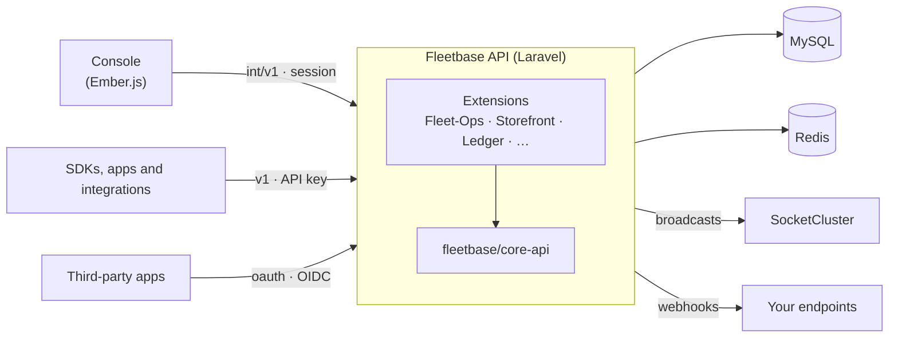

<div id="hero">
  <p align="center">
    <a href="https://fleetbase.io" rel="nofollow">
      
    </a>
  </p>
  <p align="center">
    <a href="https://github.com/fleetbase/core-api/actions/workflows/ci.yml"></a>
    <a href="https://codecov.io/gh/fleetbase/core-api"></a>
    <a href="https://packagist.org/packages/fleetbase/core-api"></a>
    <a href="https://packagist.org/packages/fleetbase/core-api"></a>
    <a href="https://packagist.org/packages/fleetbase/core-api/stats"></a>
    <a href="LICENSE.md"></a>
    <a href="https://discord.gg/V7RVWRQ2Wm"></a>
  </p>
  <p align="center">
    <strong>The core API and extension framework of Fleetbase, the open-source logistics and supply chain operating system.</strong>
    <br />
    <a href="https://www.fleetbase.io/docs" rel="nofollow">Documentation</a>
    ·
    <a href="https://www.fleetbase.io/docs/api" rel="nofollow">API Reference</a>
    ·
    <a href="https://www.fleetbase.io/docs/extension-development/getting-started/quickstart" rel="nofollow">Build an Extension</a>
    ·
    <a href="https://github.com/fleetbase/fleetbase">Fleetbase</a>
    ·
    <a href="https://discord.gg/V7RVWRQ2Wm" rel="nofollow">Discord</a>
  </p>
  <hr />
</div>

## What is core-api?

`fleetbase/core-api` is the Laravel package at the center of every Fleetbase installation. It provides the platform itself (organizations, users, access control, API keys, webhooks, notifications, files, realtime events and more) and the framework that every Fleetbase extension is built on. [Fleet-Ops](https://github.com/fleetbase/fleetops), [Storefront](https://github.com/fleetbase/storefront), [Ledger](https://github.com/fleetbase/ledger) and the rest of the extensions add their own models, routes and console screens on top of it. They share its tenancy, authentication, permissions, REST conventions and event pipeline.

You rarely install this package by hand. It ships inside the [Fleetbase API](https://github.com/fleetbase/fleetbase/tree/main/api), and you get it by [running Fleetbase](https://www.fleetbase.io/docs/platform/quickstart/running-locally). Read on if you are building an extension, contributing to the core, or want to know what the platform API provides.

## Table of Contents

- [Where it fits](#where-it-fits)
- [What's included](#whats-included)
- [Requirements](#requirements)
- [Installation](#installation)
- [Building on core-api](#building-on-core-api)
- [Querying the REST API](#querying-the-rest-api)
- [Extension points](#extension-points)
- [Configuration](#configuration)
- [Artisan commands](#artisan-commands)
- [Development](#development)
- [Contributing](#contributing)
- [Security](#security)
- [Community & support](#community--support)
- [License](#license)

## Where it fits



Core-api serves three audiences on three route groups:

| Route group | Prefix | Authenticated by | Used by |
|---|---|---|---|
| Internal | `int/v1` | Console session (Sanctum), `fleetbase.protected` middleware | The Fleetbase console |
| Public | `v1` | API key (Bearer or Basic auth), `fleetbase.api` middleware | SDKs, mobile apps, integrations |
| OAuth / OIDC | `oauth`, `.well-known` | OAuth 2.0 access tokens | Apps using "Continue with Fleetbase" |

Extensions follow the same split. Fleet-Ops, for example, serves its console routes under `int/v1` and its public API under `v1`.

## What's included

| Area | Capabilities |
|---|---|
| **Organizations and identity** | Multi-tenant companies, users, invites, onboarding, groups, user devices and presence. Two-factor authentication, social sign-in (Google, Microsoft, GitHub, Apple) and admin tools for user impersonation, account recovery and user deletion. |
| **Access control** | Roles, policies and permissions built on `spatie/laravel-permission`, with per-extension permission schemas generated by `fleetbase:create-permissions`. |
| **API platform** | Live and test API keys with a fully separate sandbox database, per-key rate limiting with organization overrides, request logging and API events, plus query and model caching with ETag support. |
| **Sign in with Fleetbase** | An OAuth 2.0 / OpenID Connect provider (authorization code + PKCE, refresh token rotation, revocation, ID tokens, discovery, JWKS) and RFC 7591 dynamic client registration for software installed on many sites. Extensions can register their own scopes. |
| **Webhooks** | Webhook endpoints managed from the console or with an API key. Each endpoint has its own signing secret, deliveries are retried with backoff, and every request is logged. Models opt in to `created`, `updated` and `deleted` events with the `SendsWebhooks` trait. |
| **Realtime** | Resource lifecycle events broadcast over SocketCluster, with optional signed channel authentication that extensions plug their own channel resolvers into. |
| **Notifications** | A notification registry that companies configure from the console. Delivery goes over mail (including Microsoft Graph), database, broadcast, APNs, FCM and SMS. |
| **SMS** | Twilio, Vonage, MessageBird, AWS SNS, CallPro, SMPP and a custom HTTP gateway, routed by number prefix. An SMS guard sits in front of every send, with destination validation, per-number/IP/tenant budgets, automatic pausing for pumping traffic and a send ledger. |
| **Files** | Uploads (multipart and base64) to local, S3 or Google Cloud Storage, with image processing. Stored extensions are checked against the detected content type. |
| **Collaboration** | Chat channels, messages, attachments and read receipts, threaded comments, an activity log, custom fields and values, categories, and dashboards with widgets. |
| **Reports and templates** | A report builder over a schema registry that extensions add tables to. Reports can run on a schedule and export to Excel or CSV. Templates render to HTML or PDF with variables, formulas, loops and data queries. |
| **Scheduling** | Schedules, schedule items, templates, exceptions, availability and constraints, materialized daily by a background job. |
| **Operations** | Scheduled database backups to any disk, log purging, tenant data purge, a queue health check, schedule monitoring, App Review access for app store reviewers, Fleetbase Hosted Routing registration and Sentry integration. |

## Requirements

- PHP 8.1 or newer
- Laravel 9 or 10 (the Fleetbase API runs Laravel 10)
- MySQL 8 with spatial support, and a sandbox connection for test-mode data
- Redis for cache, queues and rate-limit metrics
- A [SocketCluster](https://github.com/fleetbase/fleetbase/tree/main/socket) server for realtime events (optional for development)

## Installation

To run Fleetbase, follow the [Fleetbase quickstart](https://www.fleetbase.io/docs/platform/quickstart/running-locally). It includes this package.

To add core-api to your own Laravel application or extension:

```bash
composer require fleetbase/core-api
```

Laravel discovers `CoreServiceProvider`, `EventServiceProvider` and `SocketClusterServiceProvider` automatically. The package brings its own migrations, config, routes and scheduled tasks. A fresh install is set up with:

```bash
php artisan mysql:createdb
php artisan migrate --force
php artisan sandbox:migrate --force
php artisan fleetbase:seed
php artisan fleetbase:create-permissions
```

The scheduler (`php artisan schedule:run`) and a queue worker must be running for webhooks, notifications, log purging, backups and schedule materialization.

## Building on core-api

An extension is a Composer package whose service provider extends `CoreServiceProvider`. Its models, controllers, resources and filters follow core-api's conventions, so a few classes get you a complete REST resource with filtering, sorting, pagination, relationships, permissions, caching, webhooks and realtime events.

The [extension development guide](https://www.fleetbase.io/docs/extension-development/getting-started/quickstart) covers scaffolding, the console engine and publishing. What follows is the server side.

### Service provider

```php
namespace Fleetbase\Parcels\Providers;

use Fleetbase\Providers\CoreServiceProvider;

class ParcelsServiceProvider extends CoreServiceProvider
{
    public $observers = [
        \Fleetbase\Parcels\Models\Parcel::class => \Fleetbase\Parcels\Observers\ParcelObserver::class,
    ];

    public $commands = [
        \Fleetbase\Parcels\Console\Commands\SyncCarriers::class,
    ];

    public function register()
    {
        $this->app->register(CoreServiceProvider::class);
        $this->mergeConfigFrom(__DIR__ . '/../../config/parcels.php', 'parcels');
    }

    public function boot()
    {
        $this->registerCommands();
        $this->registerObservers();
        $this->registerExpansionsFrom(__DIR__ . '/../Expansions');
        $this->registerTransformersFrom(__DIR__ . '/../Http/Transformers');
        $this->loadRoutesFrom(__DIR__ . '/../routes.php');
        $this->loadMigrationsFrom(__DIR__ . '/../../migrations');
    }
}
```

`CoreServiceProvider` also gives extensions `$middleware` (middleware groups), `$transformers`, `scheduleCommands()` and `mergeConfigFromSettings()`.

### Model

```php
namespace Fleetbase\Parcels\Models;

use Fleetbase\Models\Company;
use Fleetbase\Models\Model;
use Fleetbase\Traits\HasApiModelBehavior;
use Fleetbase\Traits\HasPublicId;
use Fleetbase\Traits\HasUuid;
use Fleetbase\Traits\SendsWebhooks;
use Illuminate\Database\Eloquent\Relations\BelongsTo;

class Parcel extends Model
{
    use HasUuid;
    use HasPublicId;
    use HasApiModelBehavior;
    use SendsWebhooks;

    protected $table             = 'parcels';
    protected $publicIdType      = 'parcel';            // public ids look like parcel_8Xk2pQa
    protected $fillable          = ['company_uuid', 'tracking_number', 'status', 'weight'];
    protected $searchableColumns = ['tracking_number'];

    // Typed relations can be requested with ?with[]=company; untyped methods cannot.
    public function company(): BelongsTo
    {
        return $this->belongsTo(Company::class);
    }
}
```

`Fleetbase\Models\Model` brings UUID primary keys, soft deletes, the configured core database connection, filters, expansions and HTTP cache invalidation. Other traits add more as needed: `HasMetaAttributes`, `HasCustomFields`, `HasApiModelCache`, `HasPolicies`, `Searchable`, `HasSandboxData` and others under [`src/Traits`](src/Traits).

### Controller and routes

```php
namespace Fleetbase\Parcels\Http\Controllers;

use Fleetbase\Http\Controllers\FleetbaseController;

class ParcelController extends FleetbaseController
{
    public string $namespace = '\\Fleetbase\\Parcels';
    public $resource         = 'parcel';
}
```

```php
// src/routes.php
Route::prefix(config('parcels.api.routing.prefix', 'parcels'))
    ->namespace('Fleetbase\Parcels\Http\Controllers')
    ->group(function ($router) {
        // Console routes: session auth, permission checks.
        $router->prefix('int/v1')->middleware(['fleetbase.protected'])->group(function ($router) {
            $router->fleetbaseRoutes('parcels', function ($router, $controller) {
                $router->post('{id}/mark-delivered', $controller('markDelivered'));
            });
        });
    });
```

`fleetbaseRoutes('parcels')` registers the full REST resource, and the callback adds custom routes under the same prefix:

| Method | URI | Action |
|---|---|---|
| `GET` | `/parcels` | `queryRecord`: filtered, sorted, paginated list |
| `GET` | `/parcels/{id}` | `findRecord`: by UUID or public id |
| `POST` | `/parcels` | `createRecord` |
| `PUT` / `PATCH` | `/parcels/{id}` | `updateRecord` |
| `DELETE` | `/parcels/{id}` | `deleteRecord` |
| `DELETE` | `/parcels/bulk-delete` | `bulkDelete` |

### Conventions

The controller resolves the rest of the stack from the model's name and the controller's `$namespace`. Each class is optional and falls back to a core default.

| Class | Convention | Fallback |
|---|---|---|
| Resource (public API) | `{Namespace}\Http\Resources\v1\Parcel` | `FleetbaseResource` |
| Resource (console) | `{Namespace}\Http\Resources\Internal\v1\Parcel` | The public resource |
| Filter | `{Namespace}\Http\Filter\ParcelFilter` | Column filters on searchable fields |
| Form request | `{Namespace}\Http\Requests\CreateParcelRequest`, `UpdateParcelRequest` | `FleetbaseRequest` |

A filter method named after a query parameter runs when the parameter is present. `queryForInternal()` and `queryForPublic()` scope every query for their audience:

```php
namespace Fleetbase\Parcels\Http\Filter;

use Fleetbase\Http\Filter\Filter;

class ParcelFilter extends Filter
{
    public function queryForInternal()
    {
        $this->builder->where('company_uuid', $this->session->get('company'));
    }

    public function status(?string $status)
    {
        $this->builder->where('status', $status);
    }
}
```

## Querying the REST API

Every `queryRecord` endpoint, in core and in extensions, accepts the same parameters:

| Parameter | Example | Effect |
|---|---|---|
| `limit` | `limit=50` | Page size. Defaults to 30, capped at 100. |
| `page` / `offset` | `page=2` | Pagination. |
| `sort` | `sort=-created_at`, `sort=latest`, `sort[]=status&sort[]=-updated_at` | Ascending, or descending with a `-` prefix. `latest`, `oldest` and `distance` are shortcuts. |
| `query` | `query=acme` | Search, handled by the resource filter's `query()` method (most resources have one). |
| `{column}` | `status=delivered` | The filter method of the same name, or an exact match on a searchable column. |
| `{column}_{after\|before}` | `created_at_after=2026-01-01` | Range filters, passed to the filter's `{column}Between()` method. Other suffix pairs: `from`/`to`, `min`/`max`, `start`/`end`, `gte`/`lte`, `greater`/`less`. |
| `with[]` / `expand[]` | `with[]=company` | Eager-load relations. Only typed relations, or names listed in the model's `$withable`, are accepted. |
| `with_count[]` | `with_count[]=items` | Add relation counts. |
| `without[]` | `without[]=meta` | Hide attributes from the response. |

```bash
curl "https://api.fleetbase.io/v1/files?limit=10&sort=-created_at" \
  -H "Authorization: Bearer $FLEETBASE_API_KEY"
```

See the [API reference](https://www.fleetbase.io/docs/api) for every public endpoint.

## Extension points

Extensions plug into the platform through registries, usually from their service provider's `boot()`:

| Extension point | API | Use it to |
|---|---|---|
| Resource transformers | `$transformers`, `registerTransformersFrom()`, `ResourceTransformerRegistry::register()` | Add or change fields on any resource's output (HTTP, webhook and broadcast payloads) without touching the resource. [Guide](docs/resource-transformers.md) |
| Realtime channels | `SocketChannelRegistry::register()`, `registerModel()`, `registerPrincipalResolver()` | Authorize subscriptions to your channel prefixes. [Guide](docs/realtime-channel-authentication.md) |
| Notifications | `NotificationRegistry::register()`, `registerNotifiable()` | Make notifications configurable per company in the console. |
| Reports | `ReportSchemaRegistry::registerTable()` | Expose your tables, columns and joins to the report builder. |
| OAuth scopes | `OAuthScopes::register()` | Let "Continue with Fleetbase" apps request access to your extension's data. |
| App Review access | `AppReview::register()` | Let app store reviewers sign in to an app your extension serves. |
| Expansions | `registerExpansionsFrom()`, classes implementing `Fleetbase\Build\Expansion` | Add macros to framework classes (`Str`, `Arr`, `Builder`, `Route`, …). |
| Webhook events | `SendsWebhooks` trait, `ResourceLifecycleEvent` | Emit `{model}.created`, `{model}.updated` and `{model}.deleted` to webhook endpoints and sockets. |
| Middleware groups | `$middleware` | Define your own API middleware stack from core's building blocks. |
| Scheduled tasks | `scheduleCommands()` | Register your commands with the scheduler. |

## Configuration

Core-api merges its own config files ([`config/`](config)) into the application. Most of them read environment variables. Many settings can also be changed at runtime from the console's admin settings, and those values take precedence over the environment. Commonly used variables:

| Variable | Default | Purpose |
|---|---|---|
| `API_PREFIX` | none | Prefix for every core route. |
| `INTERNAL_API_PREFIX` | `int` | Prefix of the console route group. |
| `DB_CONNECTION` / `SANDBOX_DB_CONNECTION` | `mysql` / `sandbox` | Live and test-mode database connections. |
| `THROTTLE_ENABLED`, `THROTTLE_REQUESTS_PER_MINUTE` | `true`, `120` | Public API rate limiting. Overridable per organization from the console. |
| `API_CACHE_ENABLED` | `true` | Query, model and relationship caching for API responses. |
| `SOCKETCLUSTER_HOST`, `SOCKETCLUSTER_PORT`, `SOCKETCLUSTER_SECURE` | | Socket server the API broadcasts to. |
| `SOCKETCLUSTER_AUTH_ENABLED`, `SOCKETCLUSTER_AUTH_KEY` | `false`, unset | Authenticated realtime channels. See the [rollout guide](docs/realtime-channel-authentication.md). |
| `OAUTH_SERVER_ENABLED`, `OAUTH_SERVER_ISSUER` | `true`, `APP_URL` | Sign in with Fleetbase. Set the issuer when the public API URL differs from `APP_URL`. |
| `OAUTH_SERVER_PRIVATE_KEY`, `OAUTH_SERVER_PUBLIC_KEY` | key files in `storage/` | Token signing keys, shared by every API instance. Generate them with `oauth-server:keys`. |
| `SMS_DEFAULT_PROVIDER` | `twilio` | Default SMS provider. Each provider has its own `*_ENABLED` and credential variables in [`config/sms.php`](config/sms.php). |
| `SMS_GUARD_ENABLED`, `SMS_GUARD_MODE` | `true`, `enforce` | SMS abuse protection. `monitor` logs what would have been blocked. |
| `DB_BACKUP_ENABLED`, `DB_BACKUP_DISK`, `DB_BACKUP_FREQUENCY` | | Scheduled database backups. Also configurable under Admin → Database Backups. |
| `ROUTING_AUTO_REGISTER` | `true` | Offer a free Fleetbase Hosted Routing key during first-admin onboarding. `false` hides the offer. |
| `TELEMETRY_DISABLED` | `false` | Turns off the daily instance telemetry ping. |

## Artisan commands

| Command | Description |
|---|---|
| **Setup** | |
| `mysql:createdb` | Create the database schema from the database config. |
| `sandbox:migrate`, `sandbox:sync`, `sandbox:init-key` | Migrate the sandbox database and keep it in sync with production. |
| `fleetbase:seed` | Run the Fleetbase seeders. |
| `fleetbase:create-permissions` | Create or reset all permissions, policies and roles. |
| `fleetbase:assign-admin-roles` | Give every company owner the Administrator role. |
| **Users and recovery** | |
| `fleetbase:user-delete` | Preview and delete a user and their identity-bound records. |
| `fleetbase:recovery`, `fleetbase:fix-user-companies` | Repair accounts and company memberships. |
| **OAuth provider** | |
| `oauth-server:keys` | Generate the token signing key pair. |
| `oauth-server:client` | Register, rotate or list OAuth apps. |
| `oauth-server:prune` | Delete expired codes and tokens and unused self-registered clients. |
| **SMS guard** | |
| `sms:mode`, `sms:pause`, `sms:unpause` | Switch between enforce and monitor, and pause or resume SMS for a tenant or the platform. |
| `sms:ledger:prune` | Mask and delete old SMS ledger rows. |
| **Maintenance** | |
| `db:backup` | Dump, upload and rotate database backups. |
| `purge:api-logs`, `purge:webhook-logs`, `purge:activity-logs`, `purge:scheduled-task-logs` | Purge logs, with optional backups first. |
| `purge:orphaned-model-records` | Remove role, policy and permission assignments whose model is gone. |
| `reports:run-scheduled` | Run scheduled reports that are due. |
| `queue:status` | Check the queue connection. |
| `routing:register` | Get a free Fleetbase Hosted Routing key for this install. |

The provider schedules log purging, OAuth pruning, sandbox sync, schedule materialization, database backups and telemetry on its own. Your application only needs to run the scheduler.

## Development

```bash
git clone https://github.com/fleetbase/core-api.git
cd core-api
composer install
```

| Command | Runs |
|---|---|
| `composer lint` | PHP CS Fixer, fixing in place |
| `composer test:lint` | PHP CS Fixer, dry run |
| `composer test:types` | PHPStan |
| `composer test:unit` | Pest |
| `composer test:date-drift` | Checks for tests that will break as the calendar moves on |
| `composer test:coverage` | Pest with a coverage report |
| `composer test` | Lint, date drift, types and unit tests |

CI runs lint, date drift, the unit suite and coverage on every pull request to `main`, `dev-v*` and `release/v*` ([`ci.yml`](.github/workflows/ci.yml)). It also runs the Core API Postman collection against a live Fleetbase stack with this branch swapped in ([`postman.yml`](.github/workflows/postman.yml)).

To work on core-api inside a running Fleetbase stack, use the [development setup](https://www.fleetbase.io/docs/platform/quickstart/development-setup). It mounts local packages into the API container.

## Contributing

Contributions are welcome. Read [CONTRIBUTING.md](CONTRIBUTING.md), run `composer test` before opening a pull request, and record notable changes in [CHANGELOG.md](CHANGELOG.md). Release notes for each version are in [RELEASE.md](RELEASE.md) and on the [releases page](https://github.com/fleetbase/core-api/releases).

## Security

Please do not report security vulnerabilities in public issues. Follow the [Fleetbase security policy](https://github.com/fleetbase/fleetbase/blob/main/SECURITY.md) or email [hello@fleetbase.io](mailto:hello@fleetbase.io).

## Community & support

- [Discord](https://discord.gg/V7RVWRQ2Wm) for questions and discussion with the team and community
- [GitHub Discussions](https://github.com/orgs/fleetbase/discussions) for ideas and longer-form questions
- [Issues](https://github.com/fleetbase/core-api/issues) for bugs in this package
- [Support plans](https://www.fleetbase.io/docs/community/support-plans) for commercial support

## License

Fleetbase is dual-licensed.

**Open source (AGPL-3.0-or-later).** This package is released under the [GNU Affero General Public License v3.0 or later](LICENSE.md). If you modify it and make it available to others over a network, you must release those modifications under the same license.

**Fleetbase Commercial License.** The commercial license removes the AGPL obligations, so you can keep modifications proprietary, build SaaS products or white-label Fleetbase. See the [licensing overview](https://fleetbase.io/licensing) and the [Commercial License](https://fleetbase.io/licensing/commercial), or contact [hello@fleetbase.io](mailto:hello@fleetbase.io).

---

**Copyright © 2026 Fleetbase Pte. Ltd.**
